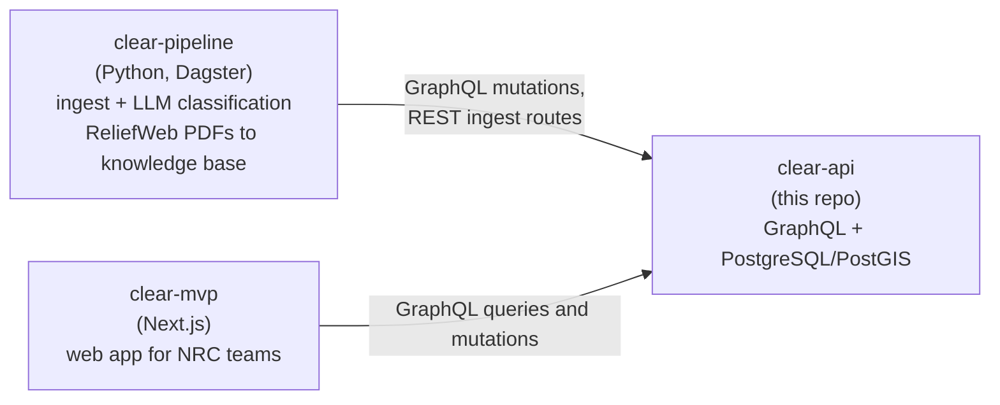

# clear-api

The GraphQL backend for **CLEAR** (Crisis Learning, Early-warning, Anticipation, and Response), a
humanitarian decision-support platform built with the Norwegian Refugee Council (NRC). It holds the
authoritative record of everything CLEAR knows about a crisis — places, incoming reports, the events
they describe, published alerts, and analyst-curated crises — and serves it to the web app and to
the data pipelines that feed it. If you change what CLEAR stores, you change it here.

## Where this fits

CLEAR runs as three repositories. Data flows one way through this API:



| Repo | Role |
| --- | --- |
| [clear-pipeline](https://github.com/CLEAR-Initiative/clear-pipeline) | Ingests signals (Dataminr and other sources), classifies them with LLMs, and turns ReliefWeb PDFs into knowledge-base entries. Writes everything through this API (GraphQL mutations and REST ingest routes). |
| **clear-api** (this repo) | The single source of truth. Owns the database schema (`prisma/schema.prisma`), authentication, and the GraphQL API. |
| [clear-mvp](https://github.com/CLEAR-Initiative/clear-mvp) | The web application used by NRC teams in Sudan, Afghanistan and Venezuela. Reads and writes through this API. |

Two rules follow from this:

- **Pipelines never write to the database directly.** Every write goes through this API, as a
  GraphQL mutation or through one of the REST ingest and upload routes under `/api` (for example
  `/api/x/ingest`, `/api/ground/ingest`, `/api/upload`), authenticated as a service user (see
  [Service users](#service-users)). Check `src/routes/` before adding a mutation for bulk ingest.
- **`prisma/schema.prisma` is the domain schema.** A change to what CLEAR stores starts here, with a
  Prisma migration.

## Domain model

The core is a five-tier graph:

```
Locations  ->  Signals  ->  Events  ->  Alerts  ->  Crises
```

- **Locations** — the administrative hierarchy (country, state, district) in PostGIS, plus level-4
  points and landmarks resolved from text by the pipeline's geoparser.
- **Signals** — raw inputs from an external source, or filed by hand. Each keeps its source payload
  and is deduplicated per source.
- **Events** — signals clustered by disaster type and place.
- **Alerts** — published advisories raised from severe events.
- **Crises** — user-curated groups of events, enriched with an LLM-generated title, summary,
  scenarios and an NRC SAF needs analysis.

Around that core sit the knowledge base (ReliefWeb document chunks with vector embeddings),
situation analyses, organisations and teams, CLEAR Agent conversations, and a task queue for
external workers ([ADR-0010](docs/adr/0010-generic-task-queue-for-heterogeneous-workers.md)).

Terms have precise meanings (for example, a null `severity` means *unknown*, never "low"). Read
[CONTEXT.md](CONTEXT.md) for the glossary and [docs/adr/](docs/adr/) for the decisions behind it.

## Tech stack

- **Runtime**: [Bun](https://bun.sh), TypeScript (strict)
- **Server**: [Apollo Server 5](https://www.apollographql.com/docs/apollo-server/) on [Express 5](https://expressjs.com/)
- **Database**: PostgreSQL with PostGIS, pgvector and pg_trgm, via [Prisma 7](https://www.prisma.io/)
- **Auth**: [Better Auth](https://better-auth.com/) (cookie sessions) plus API keys for service users
- **Storage**: S3-compatible object storage (media, attachments, knowledge-base PDFs)
- **Tests**: Vitest

## Quickstart

### Prerequisites

- [Bun](https://bun.sh)
- PostgreSQL with the **PostGIS**, **pgvector** (`vector`) and **pg_trgm** extensions available.
  Migrations run `CREATE EXTENSION IF NOT EXISTS` for each; CI tests against PostgreSQL 18.
- Docker, only for `bun run test:db`
- Optional: Redis, S3-compatible storage, an SMTP or Postmark account, and a Dagster instance from
  clear-pipeline. The server starts without them; the features that need them degrade.

### Set up and run

```bash
bun install

cp .env.example .env
# Set DATABASE_URL, and BETTER_AUTH_SECRET (32+ chars):
#   openssl rand -base64 32

bunx prisma migrate deploy   # create the tables
bunx prisma generate         # generate the typed client into src/generated/prisma
bun run seed                 # optional, see below

bun dev
```

The server listens on `http://localhost:4000`:

| Path | What it is |
| --- | --- |
| `/graphql` | GraphQL endpoint; opens Apollo Sandbox in a browser (introspection is off in production) |
| `/api/auth/*` | Better Auth REST endpoints (sign-up, sign-in, sign-out, session) |
| `/docs` | API docs, generated from the schema's description strings |
| `/portal` | Developer Portal: API keys, account, and the admin console at `/portal/admin` |
| `/health`, `/health/ready` | Liveness, and readiness (checks Postgres) |

`bun run seed` loads sample locations, disaster types, data sources, demo organisations and demo
accounts, including a global admin from `ADMIN_EMAIL` / `ADMIN_PASSWORD`. It **deletes existing
locations, signals, events, alerts, organisations and related rows first** (users, sessions and API
keys are kept), so run it only on a disposable local database. `bun run prisma/seed.ts --locations`
also **deletes all existing locations** and replaces them with the sample set; it does not top up a
populated database.

New sign-ups land with role `pending` on the Welcome page (`/portal/welcome`), where they can tell
us about themselves; API keys stay locked until an admin approves them at `/portal/admin`. Set
`SIGNUP_NOTIFY_EMAILS` to have maintainers emailed about each sign-up.

### Test

```bash
bun run test        # Vitest; DB-backed suites run if DATABASE_URL points at a usable database
bun run test:db     # the full suite against a throwaway migrated Postgres in Docker (what CI runs)
bun run test:db tests/resolvers/conversation.db.test.ts   # one file
```

Use `bun run test`, not `bun test`: the latter starts Bun's built-in runner instead of Vitest.

## Key commands

| Command | What it does |
| --- | --- |
| `bun dev` | Dev server with reload (`tsx watch`) |
| `bun run build` | Regenerate `src/docs/docs-body.html`, then compile to `dist/` |
| `bun start` | Run the compiled server |
| `bun run lint` | ESLint over `src/` |
| `bun run typecheck` | `tsc --noEmit` |
| `bun run test` / `test:watch` / `test:coverage` | Vitest |
| `bun run test:ci:coverage` | DB-free suite with the coverage gate (CI's `check` job) |
| `bun run test:db` | Suite against a scratch Postgres (CI's `db-tests` job) |
| `bun run smoke` | Smoke tests in `tests/smoke` |
| `bun run seed` | Run `prisma/seed.ts` |

### Changing the schema

```bash
# On a shared database (team dev, staging, prod), only ever run:
bunx prisma migrate deploy

# After editing prisma/schema.prisma, on your local database:
bunx prisma migrate dev --create-only --name <description>
# Review prisma/migrations/<timestamp>_<description>/migration.sql.
# Prisma cannot see the knowledgebase table's HNSW/GIN indexes or its trigger, and may
# propose dropping them on an unrelated change. Delete any such lines, then:
bunx prisma migrate deploy
bunx prisma generate
```

Never run `prisma migrate reset` against a database you care about.

## Configuration

Copy `.env.example` to `.env`; it documents every variable. Validation lives in
`src/utils/env.ts` and the server will not start if it fails.

| Variable | Purpose | Default |
| --- | --- | --- |
| `DATABASE_URL` | PostgreSQL connection string | required |
| `BETTER_AUTH_SECRET` | Auth secret, 32+ characters | required |
| `BETTER_AUTH_URL` | This server's public origin (no path) | required |
| `PORT` | Listen port | `4000` |
| `NODE_ENV` | `development`, `staging` or `production` | `development` |
| `CORS_ORIGINS` | Comma-separated allowed origins | `http://localhost:3000` |
| `FRONTEND_URL` | clear-mvp origin, used in emailed links | `http://localhost:3000` |
| `EMAIL_PROVIDER`, `SMTP_*`, `POSTMARK_*` | Outgoing email (`smtp` or `postmark`) | `smtp` |
| `SMS_PROVIDER`, `TWILIO_*`, `ELKS46_*` | Alert SMS (`twilio` or `46elks`) | `twilio` |
| `S3_*` | Object storage for uploads | optional |
| `CELERY_BROKER_URL` | Shared Redis (name kept from the retired Celery setup) | `redis://localhost:6379/0` |
| `EMBEDDING_*` | Embedding provider for knowledge-base search; must match clear-pipeline's | see `.env.example` |
| `DAGSTER_*` | clear-pipeline's Dagster, for manual knowledge-base uploads | optional |
| `ADMIN_EMAIL`, `ADMIN_PASSWORD` | Global admin created by the seed | see `.env.example` |
| `TASK_*` | Task queue limits ([ADR-0010](docs/adr/0010-generic-task-queue-for-heterogeneous-workers.md)) | see `.env.example` |
| `SENTRY_DSN`, `SENTRY_ENV`, `SENTRY_TRACES_SAMPLE_RATE` | Error reporting | off |

`.env.example` also covers the Exponential CRM sign-up hooks, the WhatsApp hotline webhook
(`HOTLINE_*`), Buttondown, and the CLEAR Agent budget.

## Service users

Machines authenticate with API keys bound to least-privilege service users. Each script creates
the user (or refreshes it) and mints a key; `--new-key` rotates it.

| Script | Identity |
| --- | --- |
| `scripts/create-pipeline-user.ts` | `pipeline` — clear-pipeline's writes |
| `scripts/create-worker-user.ts` | `worker` — Task Workers ([ADR-0010](docs/adr/0010-generic-task-queue-for-heterogeneous-workers.md)) |
| `scripts/create-agent-user.ts` | `agent` — clear-mvp's CLEAR Agent |

Other one-off seed, import and backfill scripts live in `scripts/`. Read each script's header
comment before running it: they write to whatever `DATABASE_URL` points at, and only some (the
MSNA and WorldPop imports) default to a dry run that needs `--execute` to write.

## Project layout

```
src/
  index.ts          Express + Apollo + Better Auth wiring; every route is mounted here
  context.ts        GraphQL context (Prisma, session, user, locale)
  schema/typeDefs/  GraphQL type definitions; their """descriptions""" generate /docs
  resolvers/        One resolver file per domain area
  services/         Business logic shared by resolvers and routes
  routes/           REST routes: uploads, ingest endpoints, webhooks, health
  lib/              Prisma client and Better Auth configuration
  utils/            Env validation, auth guards, geo resolution, helpers
  docs/ portal/ home/ ui/   Server-rendered /docs, /portal and landing page
  generated/prisma/ Generated Prisma client (gitignored)
prisma/
  schema.prisma     The domain schema
  migrations/       Migration history
  seed.ts           Seed data
scripts/            Service-user, seed, import and backfill scripts
tests/              Vitest suites; tests/db holds the scratch Postgres image
docs/adr/           Architecture decision records
CONTEXT.md          Domain glossary
```

## Git flow and deployment

See [CONTRIBUTING.md](CONTRIBUTING.md) for branching, the checks every PR runs, review and
auto-merge, deployment, and where work is tracked.

### Docker

```bash
docker build -t clear-api .
docker run -p 4000:4000 --env-file .env clear-api   # runs migrations, then starts
docker compose up                                   # dev server with the source mounted
```

## License

Copyright (C) 2026 Norwegian Refugee Council.

This program is free software: you can redistribute it and/or modify it under the terms of the GNU
Affero General Public License as published by the Free Software Foundation, either version 3 of the
License, or (at your option) any later version. See [`LICENSE`](./LICENSE) for the full text.
